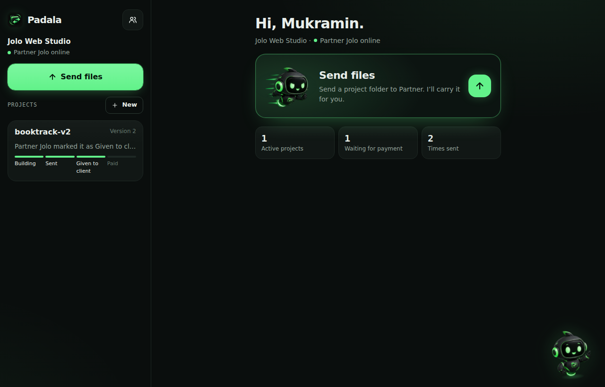
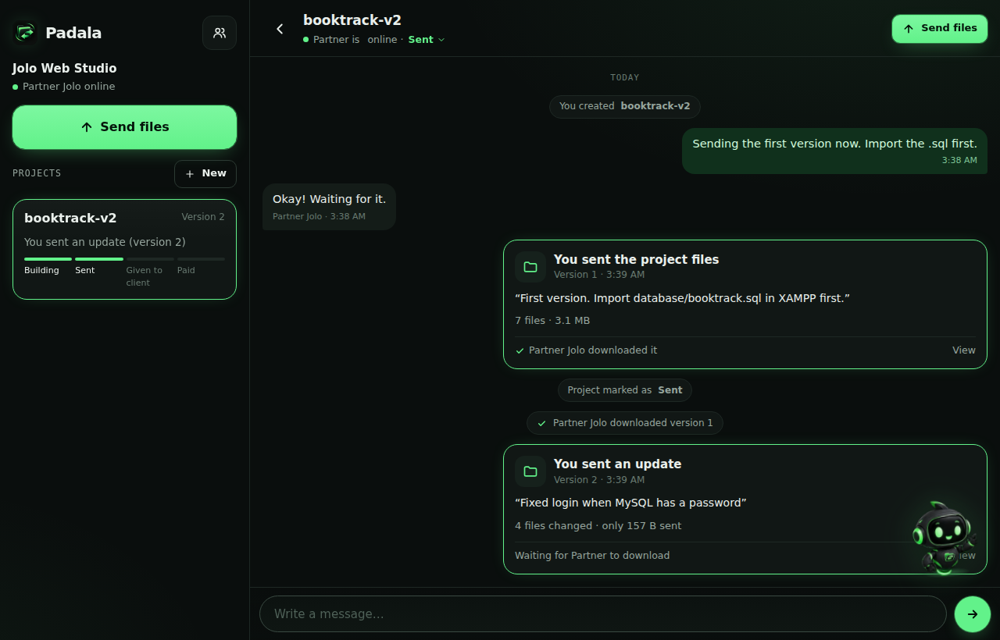
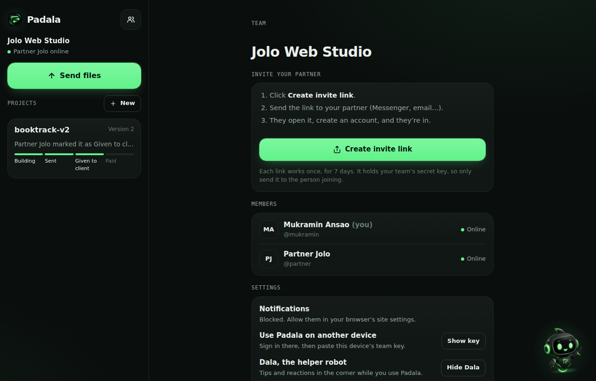
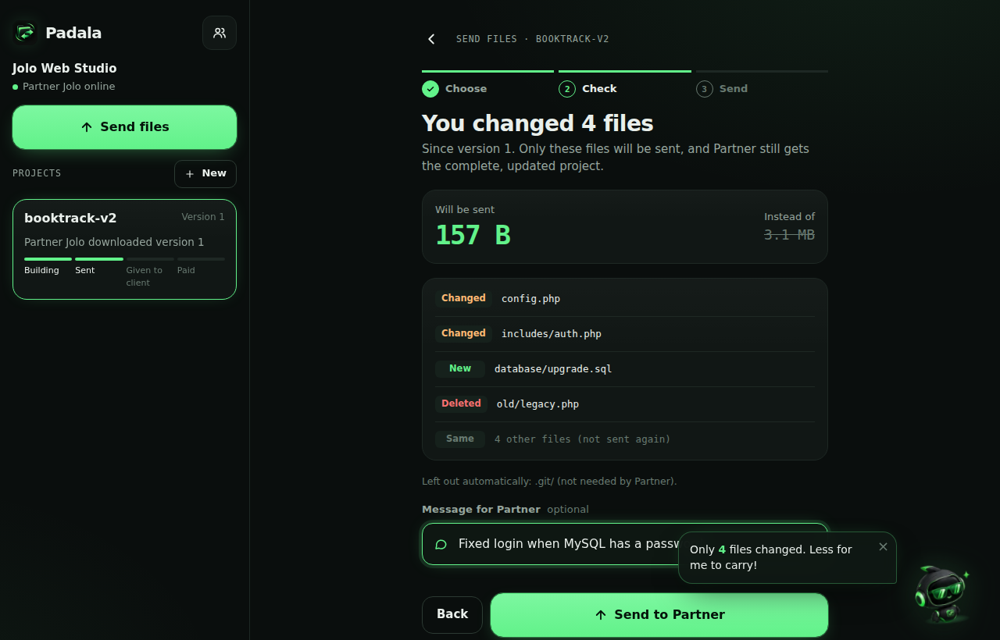
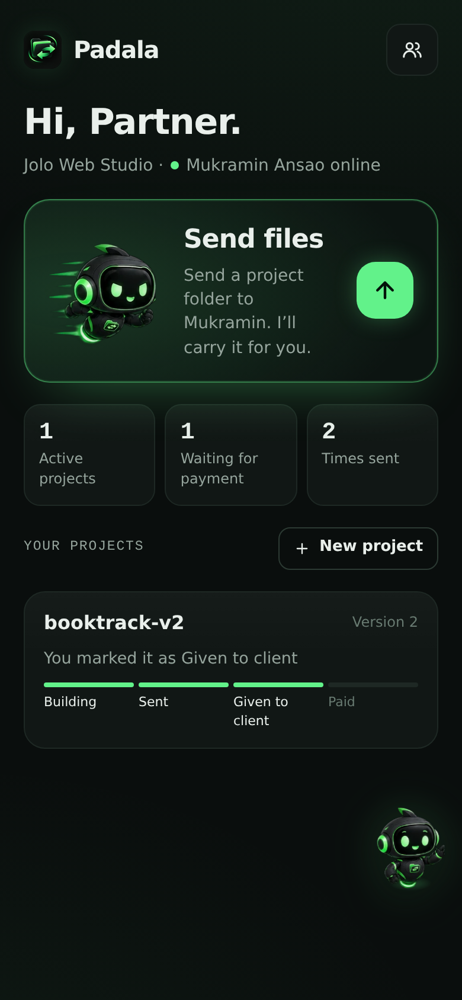
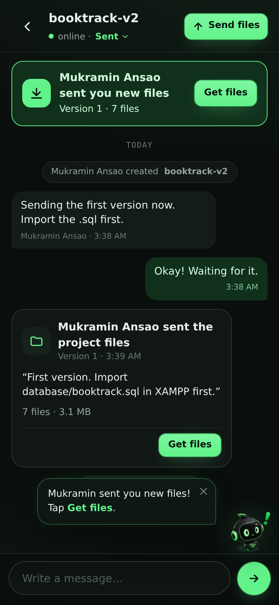
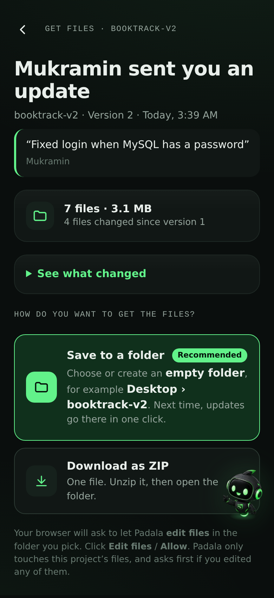
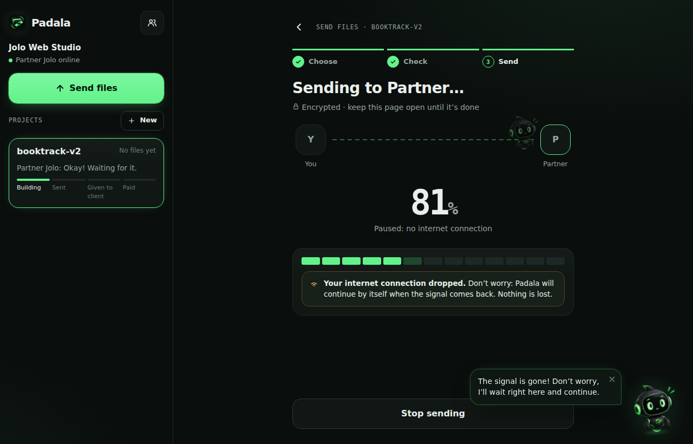
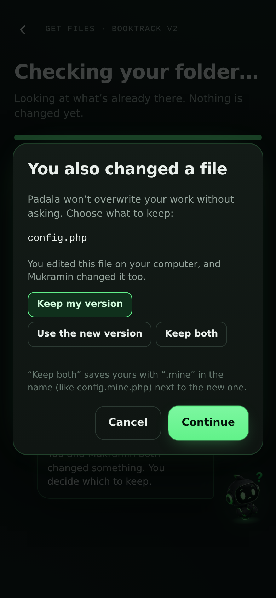

# Padala

[](https://github.com/mukraminbariwa5-create/Padala/actions/workflows/ci.yml)


**Encrypted project delivery for small web-dev teams.** Send a whole project folder to your partner, chat about it in the same place, and when you fix something, send **only the files that changed**. The receiver's folder is updated in place, and their own edits are never silently overwritten.

I built it for a real problem: I build websites in Manila, my partner hands them over to clients in Jolo, Sulu, and the signal there is weak. Messenger can't send folders, Drive links pile up, and every small fix meant re-sending the whole project.

| Home | Project chat with details |
|---|---|
|  |  |

| Team and invites | Sending only what changed |
|---|---|
|  |  |

| Phone: home | Phone: chat | Phone: a delivery | Signal drops mid-transfer | Both sides changed a file |
|---|---|---|---|---|
|  |  |  |  |  |

How it's built, with diagrams: **[docs/ARCHITECTURE.md](docs/ARCHITECTURE.md)**.

## What makes it different

- **Send only what changed.** Every file gets a fingerprint. An update compares your folder with the last version and uploads just the new and changed files: a 3 MB project with a one-line fix sends a few hundred bytes.
- **Update my copy in one click.** On Chrome or Edge, the receiver saves into a folder once; after that, every update goes straight into it and only the changed files are replaced. A hidden `.padala.json` remembers which version the folder is on.
- **Meet Dala.** A little robot helper lives in the corner: waves hello, carries your files while they send, looks worried when the signal drops, cheers when they arrive, points out new files, blinks, follows your pointer and dozes off when you’re away. Click it for tips, or hide it in Settings.
- **Look before you download.** Every file in a delivery can be previewed first: code with line numbers, images, PDFs, video and audio. Only that one file is unlocked, in memory, until you choose to download it.
- **Just send a folder.** No setup: pick a folder and Padala works out if it’s new or an update to something you sent before (by folder name and contents), and asks if it looks different.
- **Several teams.** One team per partner or topic (your web partner, a group of thesis clients…). Each has its own people, projects and secret key; switch from the top of the sidebar, with unread badges and notices from the others.
- **Dala, the helper who carries your files.** While files send, Dala flies the package across to your partner (stopping under a cloud when the signal drops) and hands it over. Before sending, Dala checks the folder: email passwords or keys left in the code, a missing `.sql` database file, backups and logs that don't need to travel (leave them out with one click, remembered next time). The receiver gets Dala's **setup notes** (put it in htdocs, import the database, open this address; or npm install, php artisan serve…) with copy buttons and a plain version to paste to the client. Dala also nudges you about files waiting to be downloaded and can send a reminder.
- **A real app on every screen.** Install it on a phone or computer (its own icon, full screen, shortcuts). On computers: a sidebar, a dashboard home, a sortable project table, a details panel next to each chat, and a Settings menu. On phones: a bottom tab bar, pull to refresh, and swipe a message to reply. Opens with an intro where Dala says hello (by name when you're signed in).
- **Tidy up.** Rename or delete projects (deleting frees the stored files that no other project uses). Teams have no delete button: anyone can leave, anyone still inside can invite new people, and when the last person leaves the team is deleted for good.
- **Made for beginners.** One big **Send files** button, a 3-step guide (Choose → Check → Send), a “new files” banner with **Get files**, plain words instead of jargon, and a heads-up before every browser permission pop-up.
- **Conflicts are asked, never guessed.** If both sides changed the same file (say `config.php` with the client's database password), the receiver chooses: keep mine, use the new one, or keep both (`config.mine.php`).
- **Built for weak signal.** Files move in 512 KB encrypted pieces. When the connection drops, Padala waits and continues from the exact piece where it stopped.
- **End-to-end encrypted.** Files, messages and notes are encrypted in the browser with AES-256-GCM before upload. The team key lives only on members' devices; it travels in the invite link's `#fragment`, which browsers never send to the server.
- **One place per project.** Chat, deliveries (v1, v2, v3…), download receipts, and a status bar: Building → Sent → Handed over → Paid.
- **Installable app.** Works as a PWA on phones and computers, in the browser, with no app store.
- **Never locked out.** Team keys are backed up locked with an account key only you can open (with your password, or with a 24-character **recovery code** shown once at sign-up). Sign in on a new phone and your teams unlock by themselves; forget your password and the recovery code resets it without losing a file. Change your password any time from Settings.
- **Fast, and the page never freezes.** Files are fingerprinted four at a time and sent six files (three pieces each) at once, within a 64 MB memory budget. On a slow 80 ms connection, a 12 MB project went from 27 s to 3 s to send.
- **Live, even through tunnels and mobile data.** New files and messages appear by themselves (long polling that gets through every proxy), and **notifications** arrive even when Padala is closed (Web Push, encrypted per RFC 8291, with no extra packages).
- **Share to Padala.** On Android, share photos or files from any app straight into Padala.
- **Chat like a chat app.** Reply to a message, copy it, or delete your own. Profile photos (cropped and shrunk on the device).
- **Storage under control.** See what each project uses, and keep only the last 10, 5, 3 or 1 versions to save space.
- **Backups.** Every day, a copy of the database and any new encrypted pieces (the last 7 days kept). Restore with one command.
- **Light or dark, English or Filipino.** Light by default; switch in Settings. The whole app, including Dala, error messages and notifications, is available in Filipino.
- **Zero dependencies.** The server uses only Node.js built-ins (`node:http`, `node:sqlite`, `node:crypto`). No `npm install`, nothing to go out of date.

## How it works

```
 Your browser                                   Server                          Partner's browser
 ─────────────                                  ──────                          ─────────────────
 read folder → fingerprint each file (HMAC)
 compare with last version's file list
 encrypt new pieces (AES-GCM, bound to         stores encrypted pieces
   file id + piece number)          ──PUT──►   it can't read or identify   ──GET──►  decrypt pieces
 encrypt file list + note          ──POST──►   records "v3", tells the     ──live──► "v3 is ready"
                                               team (live updates)                    update folder / .zip
```

- **Team key → derived keys (HKDF-SHA256):** an AES-256-GCM key for content, an HMAC key for file ids, and a short key check the server stores so a pasted key can be verified.
- **File ids** are `HMAC(teamKey, content)`: identical files are stored once, and the server can't tell what a file is.
- **Each piece** is encrypted with a random IV and the file id + piece number as additional data, so pieces can't be swapped or reordered.
- **Folder updates** are a three-way comparison between the version the folder was on, the new version, and what's actually in the folder now (`web/js/sync.js`).

## Run it

You need [Node.js](https://nodejs.org) 22.13 or newer (the current LTS is fine).

```bash
npm start
```

Open **http://localhost:8080**, create an account, start a team, and create an invite link for your partner.

> Encryption and folder updates need a secure page: `http://localhost` or `https://`. Plain `http://192.168.x.x` addresses won't work.

### Open it on your phone (or share it for a while)

```bash
npm run share
```

This starts Padala **and** a free Cloudflare quick tunnel that gives it a temporary `https://….trycloudflare.com` address, then prints a QR code. Scan it with your phone (Wi-Fi or mobile data both work). Invite links created while it runs use that address, and each one has a **Show QR code** button. The first run downloads Cloudflare's `cloudflared` tool into `.tools/`. The address changes every run, so for everyday use, host Padala on a server with HTTPS.

### Backups

Padala backs itself up once a day into `./backups` (the last 7 days). Point `BACKUP_DIR` at another drive or a synced folder (Google Drive, OneDrive) so a broken disk doesn't take your files with it.

```bash
npm run backup                                   # make a backup now
npm run backup -- restore backups/padala-2026-09-30.db   # restore one (stop Padala first)
```

Settings (environment variables):

| Variable | Default | What it does |
|---|---|---|
| `PORT` | `8080` | Port to listen on |
| `DATA_DIR` | `./data` | Database and encrypted pieces |
| `COOKIE_SECURE` | off | Set to `1` when served over HTTPS |
| `TRUST_PROXY` | off | Set to `1` behind a reverse proxy (for correct IPs in sign-in throttling) |
| `PUBLIC_URL` | none | The https address people use (invite links use it), e.g. `https://padala.example.com` |
| `MAX_FILE_MB` | `2048` | Largest single file |
| `MAX_TEAM_STORAGE_MB` | `20480` | Storage per team |
| `BACKUP_DIR` | `./backups` | Where daily backups go |
| `BACKUPS` | on | Set to `off` to turn daily backups off |

## Tests and checks

```bash
npm run check                  # every file parses, no unused imports, nothing left from debugging
npm test                       # encryption, keys, push, backups, folder-update logic, and the full API with two users
python tests/browser_test.py   # two browsers (computer + phone) through the whole app, plus an accessibility audit
```

The code checks and `npm test` run on GitHub on every push ([CI](.github/workflows/ci.yml)).

The API test sends a real project between two accounts, sends an update over a connection that fails every other request, checks that only the changed bytes went up, and checks that outsiders can't read anything. The browser test (Playwright) signs up two people, joins by invite link, chats live, turns the network off mid-upload, updates a folder in place, resolves a conflict, downloads the .zip, resets a password with the recovery code, and checks light mode, dark mode and Filipino. It ends with an accessibility audit of every main screen (text contrast to WCAG AA, labels and names for every control) in light and dark, on a computer and a phone.

## Security notes

- Key backup and recovery: the server stores team keys only locked with an account key, which is itself locked with keys made from your password (PBKDF2, 310,000 rounds) and from your recovery code. The server keeps only a scrypt hash of the code.
- Passwords: scrypt. Sessions: random tokens stored hashed, `HttpOnly` + `SameSite=Lax` cookies.
- Every write request needs a custom header and a same-site `Origin`, which blocks cross-site request forgery.
- Sign-in is locked for 5 minutes after 5 failed attempts per username (20 per IP), stored in the database.
- Strict Content-Security-Policy (`script-src 'self'`), no inline scripts, all user text escaped.
- The server checks team membership on every project, message and piece.
- What the server can see: account names, team and project names, statuses, file sizes and timing. It can't see file contents, file names, messages or notes.

## Project structure

```
server/             Node.js server, no packages
  index.js          HTTP server, security headers, compressed static files with ETags
  api.js            JSON API (accounts, teams, projects, chat, pieces, versions)
  events.js         live updates (long polling + Server-Sent Events) and who's online
  push.js           notifications when the app is closed (Web Push, VAPID, RFC 8291)
  backup.js         daily backups of the database and encrypted pieces
  db.js             SQLite schema (node:sqlite)
  storage.js        encrypted pieces on disk
  auth.js           scrypt passwords, sessions, sign-in throttling
web/                the app (plain ES modules, no build step)
  js/app.js         start-up
  js/app/           one module per screen: home, chat, send, receive, team, settings, auth, shell…
  js/crypto.js      team key, AES-GCM, HMAC file ids
  js/transfer.js    resumable, parallel piece upload/download, send only what changed
  js/sync.js        diff and three-way folder update planning (pure functions)
  js/keyring.js     account key, key backup, recovery code
  js/i18n.js        English / Filipino (js/lang/fil.js)
  js/folders.js     File System Access API and fallbacks
  js/zip.js         .zip writer
  css/app.css       the design: tokens, components, light and dark themes
  sw.js             offline app shell, notifications, share target
tools/              share (tunnel + QR), backup and restore, code checks
tests/              node:test suites, Playwright browser test, accessibility audit
docs/               architecture notes and screenshots
```

## Roadmap

- Hosting on a server with a fixed https address
- Direct phone-to-phone transfer (WebRTC) when both people are online
- A clean client download page with the team's name, shared by code

## Author & license

Built by **Mukramin Bariwa Ansao**. MIT licensed, see [LICENSE](LICENSE).
