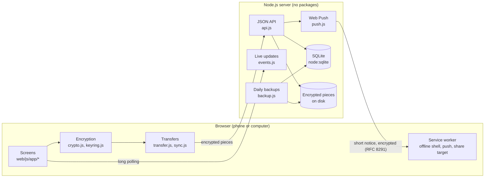
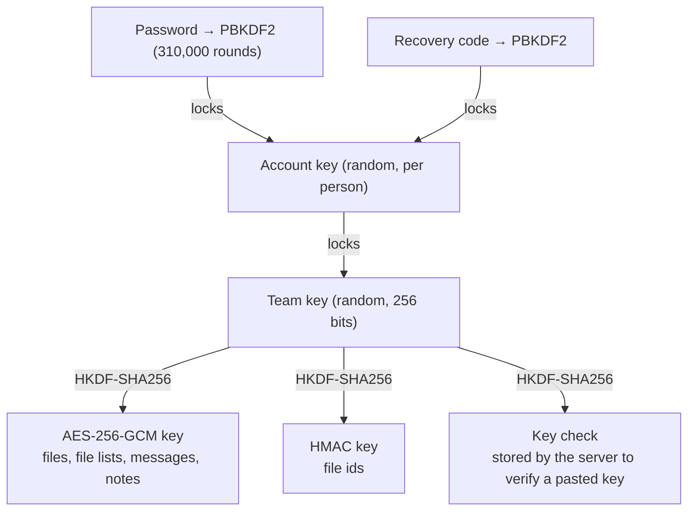
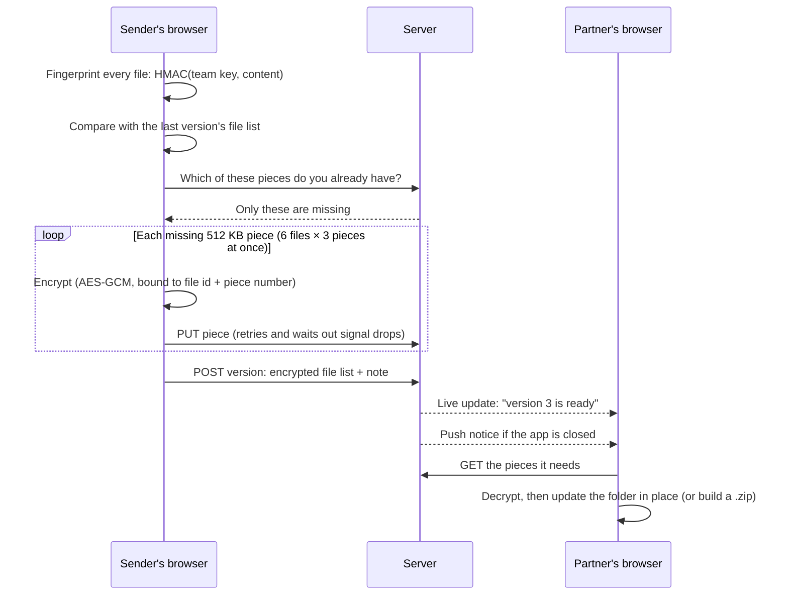

# How Padala works

Padala is a Node.js server with no dependencies and a browser app with no build step. All encryption happens in the browser, so the server stores files and messages it cannot read.

## The pieces

| Part | What it does |
|---|---|
| `server/index.js` | HTTP server, security headers (strict CSP, no inline scripts), compressed static files with ETags |
| `server/api.js` | Accounts, teams, invites, projects, chat, file pieces, versions, storage, key backups |
| `server/events.js` | Live updates by long polling (gets through tunnels and mobile proxies) and who is online |
| `server/push.js` | Notifications when the app is closed: VAPID-signed, encrypted per RFC 8291, built on `node:crypto` |
| `server/backup.js` | One database copy a day (last 7 kept) plus the encrypted pieces, restorable with `npm run backup -- restore` |
| `web/js/app/` | One module per screen: `home`, `chat`, `send`, `receive`, `team`, `settings`, `auth`, and `shell` (routing, sidebar, tab bar) |

## Keys

Each team has one secret **team key**. It is created in the browser of the person who starts the team and never reaches the server in readable form.

- **Joining a team:** the invite link carries the team key after the `#`. Browsers never send that part of a link to a server.
- **Other devices:** each person's copy of a team key is locked with their **account key**, and the account key is locked with their password. Signing in on a new phone unlocks everything on that phone. The server only ever holds locked copies.
- **Forgotten password:** the account key is also locked with a 24-character recovery code shown once at sign-up. The server keeps only a scrypt hash of the code, so the code itself is never stored.

## Sending a folder

- **Only what changed travels.** A file's id is a keyed fingerprint of its content, so an unchanged file has the same id as before and is not uploaded again. The server can't tell what a file is from its id.
- **Weak signal.** Pieces are small and each upload is retried, so a dropped connection only costs the piece in flight.
- **Updating a folder** is a three-way comparison of the version the folder was on, the new version, and what is actually in the folder now (`web/js/sync.js`). A file both sides changed is never overwritten without asking.

## What the server can and can't see

| Can see | Can't see |
|---|---|
| Account names and usernames | File contents |
| Team and project names, statuses | File names and folder structure |
| Sizes and times of uploads | Chat messages and delivery notes |
| Who downloaded which version | Team keys |

## Quality checks

- `npm run check`: every file parses, no unused imports, every app module is preloaded and cached for offline use.
- `npm test`: unit and API tests, including a transfer over a connection that fails every other request.
- `python tests/browser_test.py`: two browsers (computer and phone) through every screen, plus an accessibility audit (`tests/audit.js`) of contrast and labels in light and dark.
- GitHub Actions runs all three on every push.
